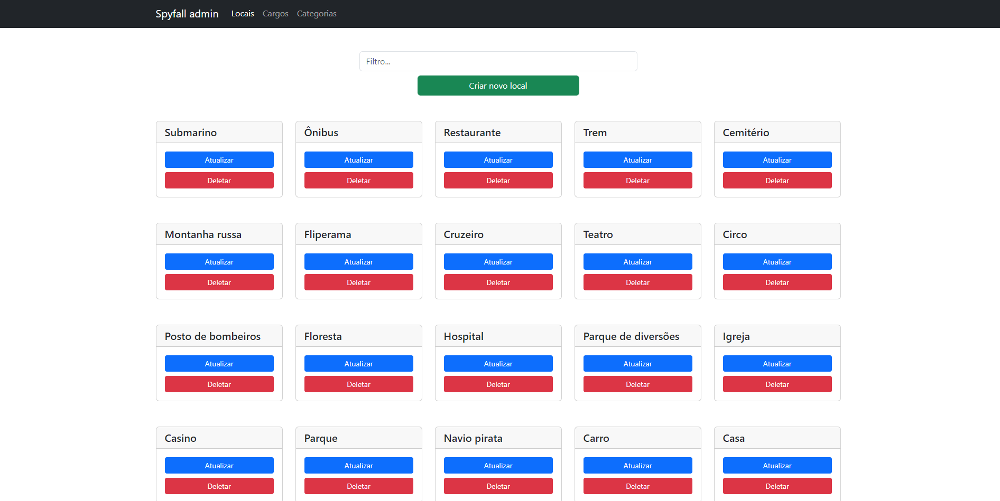
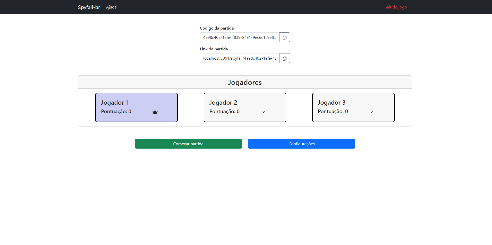
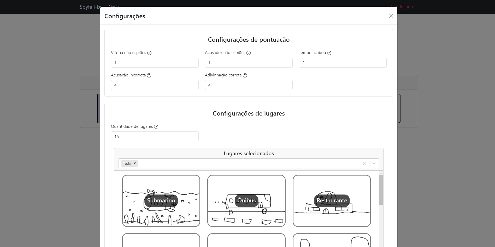
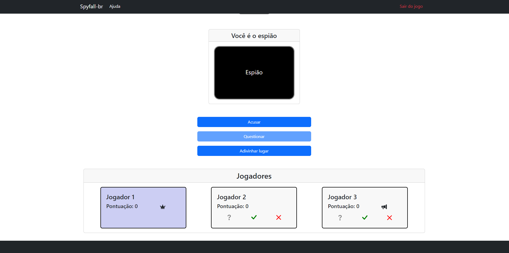
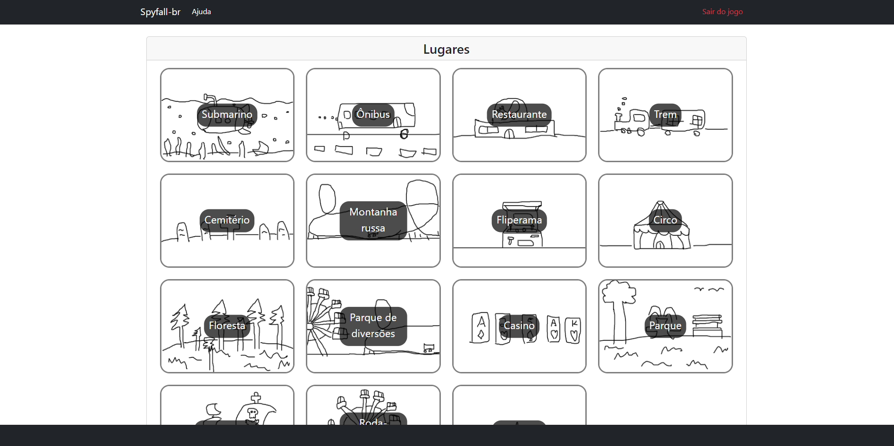
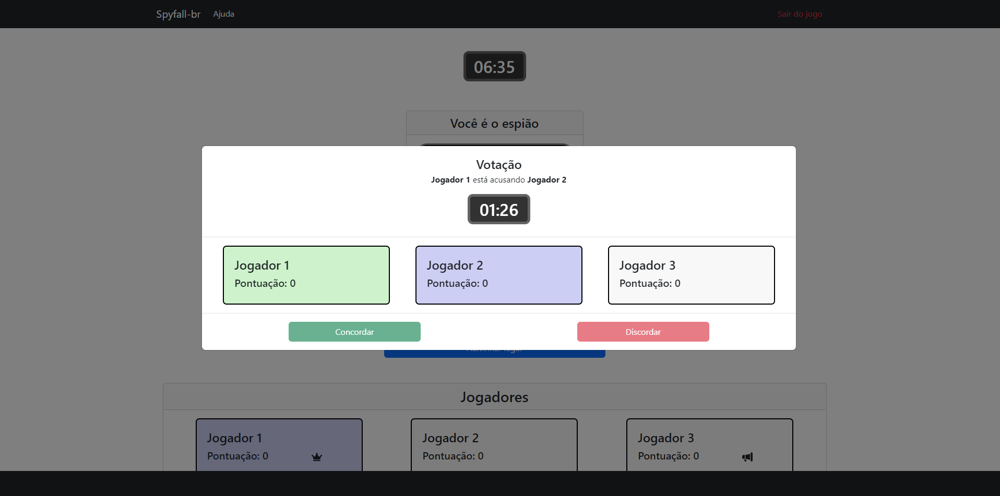
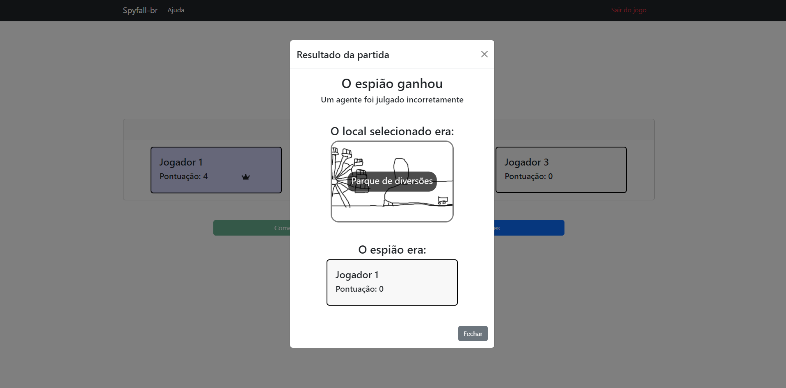

# Spyfall

Este repositório contém o código base do jogo multiplayer de tabuleiro [spyfall](https://www.spyfall.app/).

As principais tecnologias usadas no projeto foram: [React](https://react.dev/), [TypeScript](https://www.typescriptlang.org/), [Socket.io](https://socket.io/), [Bootstrap](https://getbootstrap.com/) e [Express](https://expressjs.com/pt-br/).

## Sobre o jogo

### Tutorial em vídeo

Caso prefira, existe [um tutorial em vídeo muito bom no YouTube, feito pelo canal Covil dos Jogos](https://youtu.be/OdbCMcpCR4c?si=jx8pOGtwF-S0b2Zg)

### Contexto

Você é um detetive e está em uma festa com outras pessoas. Porém, um dos presentes é um espião que não sabe onde está.

### Recomendações para jogatina

- 3 a 8 pessoas

- Todos podendo se comunicar um com os outros, sendo presencialmente ou não

- Um dispositivo para cada jogador

### Como jogar

Será sorteado uma pessoa para ser o **espião** e todos outros serão os **detetives (não espiões)**. Também será sorteado um **lugar** para onde todos estão indo. O espião não sabe onde está, mas os detetives sim. Os objetivos de cada um são:

- **Espião**: descobrir onde está, acabar com o tempo e não ser descoberto ou fazer com que outro detetive seja acusado como espião

- **Detetives**: descobrir quem é o espião

### Rodadas

No início de cada rodada, todos os jogadores, exceto o espião, recebem uma **profissão** e um **lugar**. A profissão é o que o jogador faz no lugar sorteado, podendo ser usada para fazer "atuações" daquela profissão. A atuação pela profissão é opcional, mas sempre serão sorteadas. No começo da rodada, um jogador será escolhido como questionador, tendo que escolher um dos outros jogadores para fazer **uma pergunta** a respeito do lugar. O perguntado deve responder a pergunta, buscando não dar muitos detalhes (para não dar muita informação para o espião), mas o suficiente para remover suspeitas dos outros detetives. O espião, quando perguntando ou perguntar, deve blefar, podendo soar suspeito. Existem três formas de acabar a rodada:

**Votação unanime**: a qualquer momento na partida, um jogador pode acusar outro jogador, abrindo uma votação. Para a votação ser aprovada, todos os jogadores devem concordar com ela. Caso pelo menos um dos jogadores recuse a votação, ela será encerrada e a rodada continuará normalmente. O acusado não tem poder de voto em sua acusação. Caso a votação seja aceita e o espião tenha sido o acusado, todos os detetives ganham pontos, sendo que o acusador ganha pontos extras. Caso o acusado seja um detetive, o espião ganha.
  
**Adivinhação do local**: a qualquer momento da partida o espião pode tentar adivinhar o local. Se o espião adivinhar o local corretamente, ele ganha, caso contrário, todos os detetives ganham.

**Tempo acabou**: no começo da rodada, um cronômetro será iniciado. Caso o tempo acabe, o espião ganha

## Prints do jogo

Página de edição de locais (interface para configuração de banco de dados):



Página do lobby:



Página de configurações:



Página do jogo:





(Sim, eu que desenhei essas obras artítiscas das imagens dos locais)

Página de votação/acusação:



Página de resultados:



## Instalação e execução

Existem duas formas de executar o projeto, e cada uma com uma finalidade. Uma forma de execução é o modo produção, para colocar no ar o jogo para que o público possa jogar. A outra forma é desenvolvimento, para conseguir visualizar o resultado das modificações do código ao vivo.

### Como executar - Modo produção

Para subir o servidor, é preciso ter instalado o `Docker` e o `Docker Compose`. O docker disponibiliza um [tutorial para sua instalação](https://docs.docker.com/desktop/).

Com tudo instalado, para colocar o jogo no ar em modo de produção, siga os passos abaixo:

1 - Configurar `.env`

As principais variáveis que devem ser modificadas são:

  - `DB_PATH`: endpoint para fazer requisições aos dados (lugares, cargos e categorias).
  - `ADM_PATH`: endpoint para acessar a página de administração (configurações dos dados do jogo). Para acessar a página, a URL final será: `<endereço_servidor>/<DB_PATH>`.
  - `GAME_PATH`: endpoint para acessar a página do jogo. Para acessar a página, a URL final será: `<endereço_servidor>/<GAME_PATH>`.
  - `PORT`: porta em que o jogo ficará exposto.
  - `ADM_PORT`: porta em que o servidor de administração ficará exposto, quando ele estiver ligado.

2 - `docker-compose up`
2 - `docker-compose up`

Esse comando sobe apenas o jogo.

3 - Servidor de administração (separado, opcional)

O servidor de administração é um processo separado do jogo: ele serve a página de administração e a API de escrita dos dados (criar/editar/remover lugares, cargos e categorias). Ele **não tem senha**, por isso só deve ser ligado quando for necessário e desligado logo em seguida:

```
docker compose --profile adm up adm
```

Isso sobe somente a administração (sem o jogo), em `http://localhost:3001/spyfall/adm` (porta `ADM_PORT`, caminho `ADM_PATH`). Para desligar: `docker compose stop adm`. O servidor do jogo, por sua vez, só lê os dados por essa API (`GET`); tentativas de escrita nele retornam `405`.

Esse comando irá subir o servidor no ar (esse comando funciona para o Windows, mas pode ser diferente para outro OS). Isso pode levar um tempo considerável, já que irá instalar todas as bibliotecas necessárias. Mas, uma vez feito isso, é esperado que não seja mais tão demorado para executar novamente.

### Como executar - Modo desenvolvimento

Para instalar as bibliotecas, é necessário ter o Node.js instalado. Pode ser instalado pelo [próprio site do Node.js](https://nodejs.org/en). Não é preciso nenhum banco de dados: os dados ficam em arquivos JSON (ver seção **Dados** abaixo).

Com tudo instalado, para começar a desenvolver, siga os passos abaixo:

1 - Na pasta `backend`, executar `npm install`

Instalará as bibliotecas necessárias para subir o servidor do backend.

2- Rodar o comando `npm run server`

Irá subir o servidor backend do jogo. Para subir apenas o servidor de administração (sem o jogo), rode `npm run adm` em outro terminal; ele ficará em `http://localhost:3001/spyfall/adm` e não pede senha.

3 - Escolher o frontend `spyfall-br-adm` ou `spyfall-br-game` e rodar `npm install` e depois `npm run start`.

Isso irá gerar o frontend ao vivo, podendo edita-lo e ver as modificações rapidamente. `spyfall-br-adm` é o frontend da página de administração e `spyfall-br-game` é o frontend da página do jogo.

## Dados

Não há banco de dados. Todos os dados do jogo ficam em arquivos JSON na pasta `backend/data`:

  - `backend/data/places.json`: lugares, no formato `{ "id": 1, "name": "Casa", "imgPath": "placeImgs/...png", "rolesIds": [3, 4], "categoriesIds": [2] }` (`imgPath` é opcional).
  - `backend/data/roles.json`: cargos, no formato `{ "id": 1, "name": "Piloto" }`.
  - `backend/data/categories.json`: categorias, no formato `{ "id": 1, "name": "Meio de transporte" }`.

Os servidores leem esses arquivos a cada requisição e o servidor de administração os reescreve a cada alteração (escrita em arquivo temporário + renomeação, para não corromper o arquivo). As imagens dos lugares continuam na pasta `backend/placeImgs`.

### Backup

Para fazer backup, basta copiar a pasta `backend/data` (e, se quiser as imagens, `backend/placeImgs`). Para restaurar, copie os arquivos de volta. Os IDs são números sequenciais gerados a partir do maior ID existente em cada arquivo, então também é possível editar os JSON manualmente — só mantenha os `id` únicos e os `rolesIds`/`categoriesIds` dos lugares apontando para cargos/categorias existentes.

## Idiomas

O jogo usa `i18next` com português (padrão) e inglês: alterne no seletor **PT/EN** no topo da página. A escolha fica salva no navegador (`localStorage`) e, na primeira visita, o idioma do navegador é usado quando suportado. As traduções da interface ficam em `frontend/spyfall-br-game/src/locales/` (`pt.ts` e `en.ts`). Os nomes de lugares, cargos e categorias também são traduzidos: em `backend/data`, o campo `name` é um objeto de traduções por locale, ex. `"name": { "pt": "Casa", "en": "House" }` (`pt` é obrigatório; sem `en`, vale o `pt`). No admin, os formulários de local/cargo/categoria têm campos separados para português e inglês.

## Testes

Backend (lógica do jogo, administração, store JSON e integração dos dois servidores, usando o test runner nativo do Node, sem dependências novas):

```
cd backend
npm test
```

Os testes do backend usam diretórios temporários (`DATA_DIR`), então os arquivos reais de `backend/data` nunca são alterados.

Frontends (Jest + Testing Library, já existentes nos projetos):

```
cd frontend/spyfall-br-game
npm test -- --watchAll=false

cd frontend/spyfall-br-adm
npm test -- --watchAll=false
```